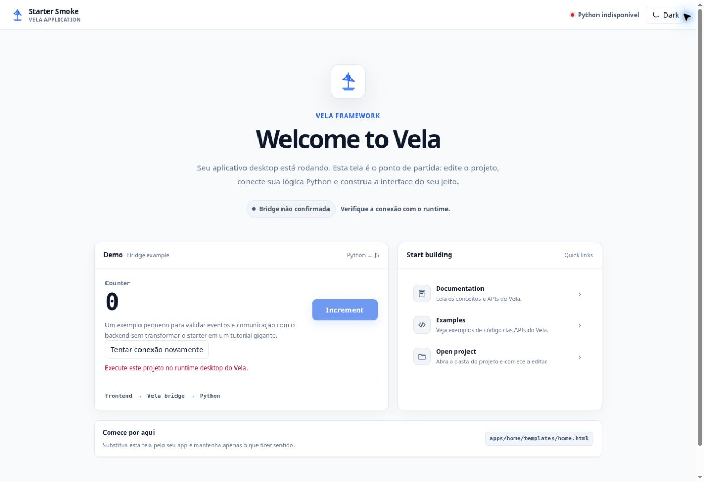
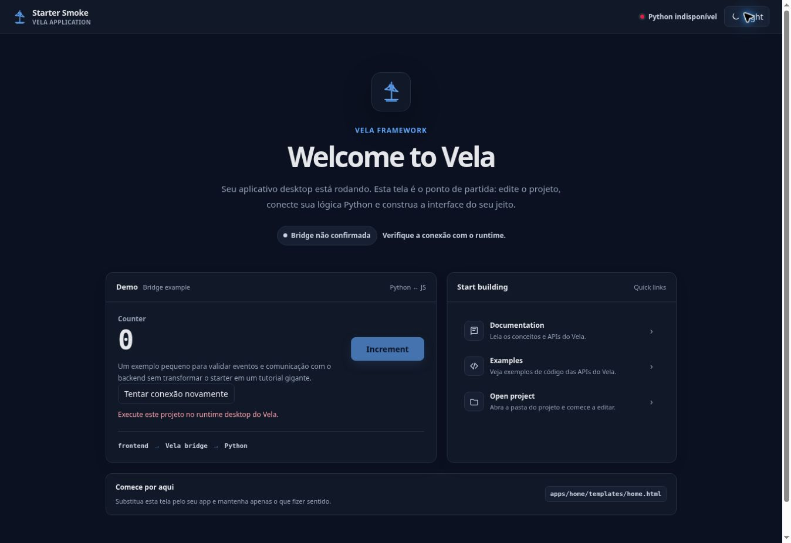

# Starter App oficial

O starter é a aplicação inicial gerada por `vela startproject`. Usa o scaffolding
existente, a rota `/home`, o template engine do Vela e a bridge real do pywebview.
Não altera projetos já criados e não depende de CDN, Node, Tailwind ou fontes externas.

## Criar e executar

Instale a versão do Vela que contém este starter no seu ambiente virtual. Então:

```bash
vela startproject meu-app
cd meu-app
python manage.py runapp
```

`vela runapp` é o equivalente global já existente. Os nomes `vela new` e `vela run`
não são comandos do framework. O nome `meu-app` vira `Meu App` em `APP_TITLE`.
Altere `config/settings.py` para personalizar título, tamanho de janela e porta.
O footer usa a versão real do pacote Vela instalado, sem número fixo no HTML.

## Estrutura gerada

```text
manage.py                           # CLI local
config/settings.py                  # configurações da aplicação
config/wsgi.py                      # coleta de assets e boot do VelaApp
config/bridge.py                    # StarterBridge com ações Python
apps/home/views/__init__.py          # registro de /home, layout blank
apps/home/views/home.py              # renderização e contexto do template
apps/home/templates/home.html        # composição da tela inicial
apps/home/static/starter.css         # estilos locais e temas
apps/home/static/starter.js          # eventos e chamadas da bridge
```

O shell do framework continua responsável pelo documento HTML e pela janela.
A view é um fragmento, renderizado com `layout="blank"`. O starter tem sua própria
topbar, portanto as barras opcionais do shell ficam desativadas no projeto novo.
Os antigos demos Login/Dashboard deixam de ser copiados para projetos novos;
projetos existentes não são modificados.

O boot coleta CSS e JS com `collect_static(skip_tailwind=True, allow_install=False)`
e os publica usando `{{ static('home/starter.css') }}` e o servidor estático normal.
Não executa instalações npm. Executáveis congelados usam os assets já coletados
pelo processo de build. Ao adicionar sua própria pipeline, adapte `config/wsgi.py`.

## Bridge e contador

`VelaApp(..., bridge_class=StarterBridge)` expõe a subclasse de `BaseBridge` pelo
mecanismo nativo já existente: `window.pywebview.api`.

```javascript
const pong = await window.pywebview.api.ping();
const next = await window.pywebview.api.increment_counter(count);
```

```python
class StarterBridge(BaseBridge):
    def increment_counter(self, value: int) -> int:
        if type(value) is not int or not 0 <= value < 1_000_000:
            raise ValueError("Valor inválido")
        return value + 1
```

O valor passa como argumento escalar; não existe `vela.invoke` no exemplo.
A interface só confirma `Python conectado` depois do retorno `pong`. O contador
só muda com o inteiro retornado pelo Python. Erros e timeout de 5 segundos mantêm
o valor anterior, mostram feedback e permitem testar a conexão novamente.
O JS remove listeners no `VelaPage.beforeUnmount`, evitando duplicação na navegação.
O tema fica no elemento do starter e é persistido com localStorage; armazenamento
bloqueado não impede o uso da interface.

O contador é demonstrativo, sem persistência e limitado a um milhão. Não representa
estado compartilhado entre janelas nem um banco de dados. Para dados reais, implemente
sua lógica Python e substitua este exemplo.

## Links e diretório do projeto

Documentation e Examples abrem URLs fixas do repositório no navegador padrão.
A documentação em si pode exigir internet; a aplicação e o contador funcionam offline.
`starter_action("project")` abre apenas a raiz definida pelo arquivo `config/bridge.py`.
A bridge não recebe caminhos, URLs nem comandos arbitrários do frontend.
Windows usa `os.startfile`; macOS/Linux usam argumentos fixos com `shell=False`.
Ambientes sem explorador de arquivos podem recusar a ação e exibir um aviso.
Em um executável congelado, a raiz é a dos recursos do aplicativo, não o checkout
original do desenvolvedor; remova essa ação quando o produto for distribuído.

## Substituir o starter

Edite `apps/home/templates/home.html`, `starter.css` e `starter.js`. Adicione suas
rotas em `apps/home/views/__init__.py`, ou registre outros apps em `config/wsgi.py`.
Remova os métodos do exemplo de `StarterBridge` quando não forem mais necessários.
Você também pode voltar a usar `BaseBridge` removendo o argumento `bridge_class`.
Nenhuma API de runtime nova ou scaffolding paralelo é necessário.

## Validação

```bash
python -m pytest -q
node --test tests/vela_docs_frontend.mjs tests/starter_frontend.mjs
python -m build
```

Os testes criam um projeto temporário, validam os arquivos e o nome renderizado,
coletam assets e executam `config.wsgi.run()` com servidor HTTP real e um adapter
de janela de teste. Chamam a StarterBridge real, validam seus argumentos e confirmam
a resposta do contador. Os testes JS verificam contador, falha sem runtime, retry,
temas e localStorage indisponível. A CI testa geração também a partir do wheel.

A conferência visual usou o HTML efetivamente renderizado pelo projeto gerado,
com os mesmos CSS/JS. Como a prévia em navegador não possui pywebview, as capturas
mostram corretamente `Python indisponível`; não foi injetada uma bridge simulada
para produzir um indicador verde. A abertura nativa do WebView e o explorador de
arquivos precisam de verificação manual no desktop Windows/Linux/macOS.

Validação local concluída: **141 testes Python e 10 testes JavaScript** aprovados,
Ruff/Black aprovados, wheel/sdist construídos e recursos verificados. Um venv novo
instalou o wheel, criou outro projeto com o CLI instalado e passou `collectstatic`,
`assets verify` e a chamada real `StarterBridge().increment_counter(41) == 42`.
A prévia foi conferida em 900×600, 1000×650, 1200×760, 1366×768 e 600×650:
nenhuma rolagem horizontal interna; em 600 px os painéis formam uma coluna.



